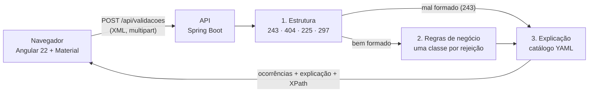

> **Projeto acadêmico (TCC), sem vínculo oficial com nenhuma Secretaria de Fazenda. Não substitui a validação da SEFAZ.**

# Assistente de Rejeições da NF-e

Aplicação web que valida o XML de uma NF-e (modelo 55, leiaute 4.00) **antes da transmissão** e explica, em português, por que ela seria rejeitada e como corrigir: o campo afetado, o que está errado e a correção, com o campo destacado no XML.

Trabalho de Conclusão de Curso da pós-graduação em Desenvolvimento FullStack (Descomplica).

- **100% offline:** nenhuma chamada a web services da SEFAZ.
- **Sem persistência:** o XML é validado em memória e descartado; no navegador, também fica só em memória.
- **Dados sintéticos:** todos os XMLs do projeto são fictícios, em homologação (`tpAmb = 2`).

## Arquitetura



1. **Estrutura:** XML bem formado (243), prefixo de namespace (404), schema XSD oficial (225, com a mensagem traduzida em campo e motivo) e assinatura (297). Se o XML não for bem formado, nada mais roda.
2. **Regras de negócio:** cada rejeição é uma classe que implementa `RegraValidacao`. As regras rodam mesmo com falha de schema e ignoram campos ausentes.
3. **Explicação:** o catálogo [`catalogo-rejeicoes.yml`](backend/src/main/resources/catalogo-rejeicoes.yml) transforma cada ocorrência em título oficial, campo, problema e correção. O texto não fica no código das regras.

As decisões de arquitetura, com contexto e alternativas descartadas, estão em [`docs/decisoes.md`](docs/decisoes.md).

## Escopo: 28 rejeições

| Grupo | Códigos |
|---|---|
| Estrutura e assinatura | 243, 225, 297, 404 |
| Chave de acesso | 502, 253 |
| Identificação | 703, 207, 208, 237, 209, 210 |
| Totais e cálculos | 564, 610, 531, 532, 528, 538, 536, 533, 534, 535, 537 |
| Regras da operação | 321, 327, 328, 598, 441 |

Os títulos e as regras foram conferidos nas fontes oficiais listadas abaixo. Ao longo do projeto, alguns códigos do escopo inicial foram trocados pelos que a SEFAZ usa na autorização da NF-e. Por exemplo, o 212 virou 703 e o 373 virou 598. O motivo de cada troca está em `docs/decisoes.md`.

## Como rodar

### Backend (Java 25, Spring Boot 4.1)

Requer JDK 25 (`JAVA_HOME`). O Maven vem pelo wrapper.

```bash
cd backend
./mvnw test
```

Para subir a API (porta 8080):

```bash
cd backend
./mvnw spring-boot:run
```

### Frontend (Angular 22)

Requer Node 24 (versão em `frontend/.nvmrc`). O Angular CLI é dependência do projeto (`npx ng`), sem instalação global.

```bash
cd frontend
npm install
npm start
```

A aplicação abre em `http://localhost:4200` e encaminha `/api` para o backend em `localhost:8080` (`proxy.conf.json`). As fontes e os ícones vêm do próprio bundle, e nada é enviado a terceiros.

Testes de componentes (Vitest):

```bash
cd frontend
npx ng test --watch=false
```

## Exemplos para demonstração

A pasta [`exemplos/`](exemplos/) tem NF-e **sintéticas**, sem nenhum dado fiscal real, assinadas com um **certificado de teste autoassinado, sem valor fiscal**. Cada arquivo leva só o certificado público; a chave privada nunca é gravada.

- `valido-*.xml`: os 5 XMLs de base, sem rejeições.
- `erro-*.xml`: um erro por grupo.
- `figura-*.xml`: os casos usados nas figuras do artigo.

O [README dos exemplos](exemplos/README.md) traz os códigos esperados de cada arquivo. Para gerar de novo:

```bash
cd backend
./mvnw test -Dtest=ExemplosAssinadosTest -Dexemplos.saida=../exemplos
```

## Avaliação

A avaliação aplica **mutações controladas** aos XMLs de base, uma ou mais por código de rejeição. Cada mutação roda em todas as bases em que o campo existe. Para cada caso, a avaliação verifica se a ferramenta detecta o erro, associa o código correto, aponta o campo correto e traz uma explicação completa. A metodologia completa está na D023.

Resultado da [execução final](docs/avaliacao/final/tabela-1.md):

| Grupo | Mutações | Casos | Detectadas | Código correto | Campo correto | Explicação completa |
|---|---:|---:|---:|---:|---:|---:|
| Estrutura e assinatura | 7 | 35 | 100% | 100% | 97,1% | 100% |
| Chave de acesso | 2 | 10 | 100% | 100% | 100% | 100% |
| Identificação | 7 | 25 | 100% | 100% | 100% | 100% |
| Totais e cálculos | 11 | 30 | 100% | 100% | 100% | 100% |
| Regras da operação | 5 | 12 | 100% | 100% | 100% | 100% |
| **Total** | **32** | **112** | **100%** | **100%** | **99,1%** | **100%** |

- **Controle negativo:** os 5 XMLs de base sem mutação passam sem nenhuma ocorrência.
- **O caso fora do esperado** (o 225 na base de devolução) é uma característica da validação por schema, discutida na D024. Não houve correções entre a execução inicial e a final.
- **Arquivos:** CSV por caso, Tabela 1 e Quadro 1 em [`docs/avaliacao/`](docs/avaliacao/), nas pastas `inicial/` e `final/`.

Para reproduzir:

```bash
cd backend
./mvnw test -Dtest=AvaliacaoTest -Davaliacao.saida=../docs/avaliacao/final
```

## Fontes oficiais e versões

- Schemas XSD: Pacote de Liberação 010g v1.03 (NT 2026.006 v1.00 e NT 2026.008 v1.00), Portal da NF-e.
- Manual de Orientação do Contribuinte (MOC) 7.0 e Anexo I (Leiaute e Regras de Validação), versão 7.00.
- NT 2020.006 v1.30 (Intermediador e Marketplace), código 441.
- Informe Técnico 2023.002 v2.10 (Tabela CFOP), códigos 327 e 328.
- SINTEGRA: algoritmos de dígito verificador da IE de MA, SP e PR.

## Limitações

- **Sem consulta à SEFAZ:** regras que dependem da base da SEFAZ (duplicidade, situação cadastral) ficam fora do escopo.
- **Certificado:** o 297 confere a integridade da assinatura, mas não a validade, a cadeia ICP-Brasil nem a revogação do certificado.
- **610 e a Reforma Tributária:** segue a fórmula do MOC 7.0, com a premissa de que as NTs da Reforma não alteraram o `vNF`.
- **IE:** é conferida para MA, SP e PR.

A lista completa, com as extensões futuras, está no fim de [`docs/decisoes.md`](docs/decisoes.md#limitações-e-extensões-futuras).

## Certificado de teste (assinatura, rejeição 297)

Os testes **não** dependem de nenhum certificado da sua máquina: cada execução gera o seu, numa pasta temporária, com o `keytool` do próprio JDK.

Para assinar XMLs fora dos testes, gere um certificado **autoassinado** de teste:

```powershell
.\scripts\gerar-certificado-teste.ps1
```

```bash
./scripts/gerar-certificado-teste.sh
```

- O certificado vai para `certificados/certificado-teste.p12`, pasta que está no `.gitignore`.
- A senha vem da variável `SENHA_CERTIFICADO_TESTE`. Sem ela, o script gera uma senha aleatória e a mostra uma única vez.
- O certificado não é ICP-Brasil e não tem valor fiscal. Serve apenas para NF-e sintéticas em homologação.

## Licença

[MIT](LICENSE) © 2026 Claudio Pablo Silva.
